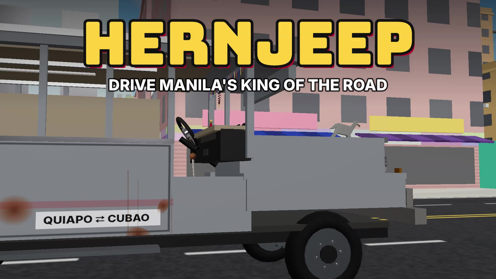
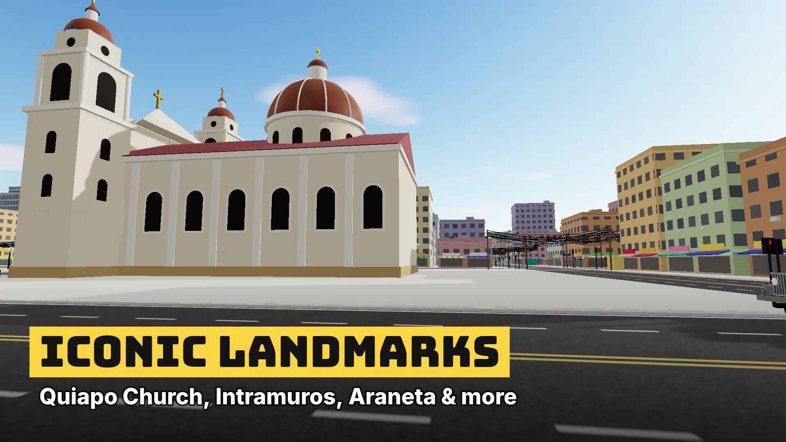
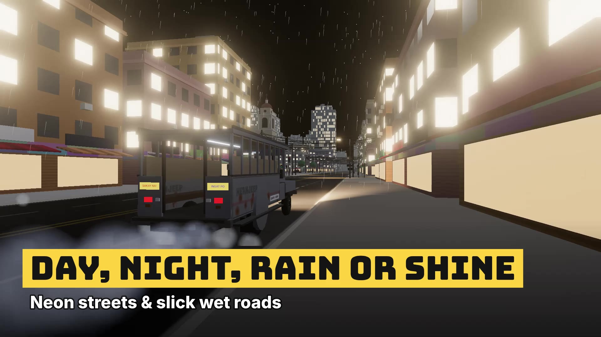
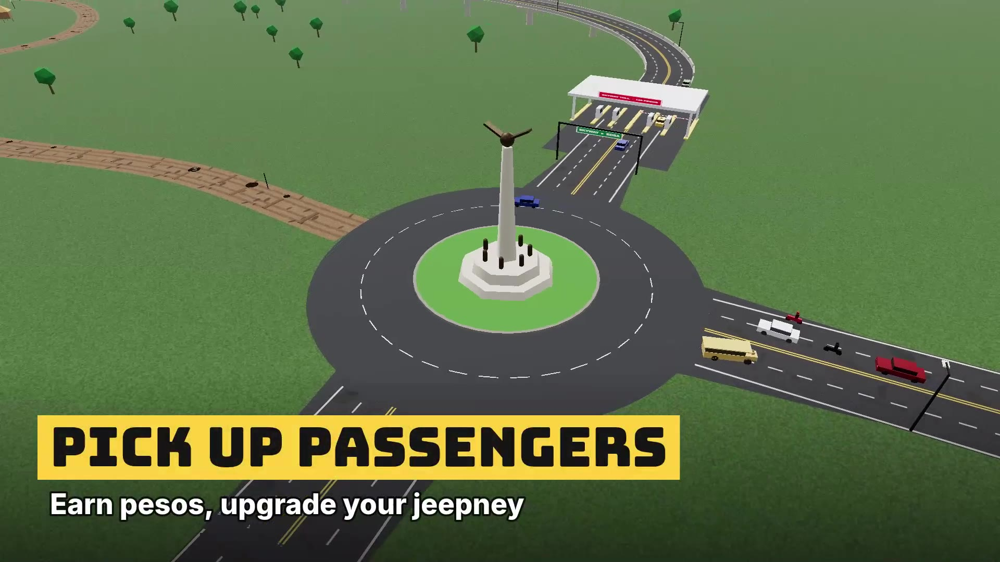

<div align="center">

# HERNJEEP: Manila Routes

### *Drive Manila's King of the Road.*

**Sakay na!** Grab the wheel of a chrome-plated, horse-topped, hand-painted jeepney and own the streets of Manila, straight from your browser. No download. No install. Just pure *biyahe*.

### [▶ Play now at hernjeep.vercel.app](https://hernjeep.vercel.app)


<a href="https://hernjeep.vercel.app"></a>


</div>

---

## Watch the Trailer

<div align="center">

<video src="assets/trailer.mp4" poster="assets/hero.jpg" controls width="100%"></video>

<sub>Video not playing? <a href="assets/trailer.mp4"><b>▶ Click here to watch the trailer</b></a></sub>

</div>

---

## Why You'll Love It

> You inherited your late Tatay's rusty old jeepney. The city is loud, the traffic is wild, and the passengers want to get to Quiapo **now**. Bring the old jeep back to glory, one fare at a time.

- **A Manila you can feel.** Rumble through **Intramuros, Quiapo and Cubao**, cruise down **EDSA** under a moving MRT, and cross **Jones Bridge** over the Pasig.
- **Iconic landmarks.** Quiapo Church, Manila Cathedral, San Agustin, Fort Santiago, Araneta Dome, Rizal Park, the Mall of Asia globe and more.
- **Real Manila traffic.** Buses, taxis, tricycles, kalesas and motorbikes that follow lanes, stop at lights, and *will* honk at you.
- **Pick up passengers.** *"Bayad po!"* *"Para po!"* Hear real Tagalog lines, collect fares, and earn pesos.
- **17 parts × 5 tiers of upgrades.** Chrome horses, roof trumpets, LED underglow, subwoofers, gold mags. Every upgrade changes how your jeep **looks, drives and sounds**.
- **Day, night, rain or shine.** Neon-lit streets, slick wet roads, thunderstorms and morning fog, with traffic that follows the rush hour.
- **Skyway, bridges & toll gates.** Stop at the plaza, pay your ₱120, and fly over the city.
- **Missions & story.** 10 story chapters, passenger and cargo jobs, time trials, a fresh daily contract, and a parking-practice lot to sharpen your skills.
- **Real driving physics.** Diesel torque, turbo lag, manual or automatic gears, tyre slip, drifting, and damage that dents your panels and cracks your windshield.
- **100% procedural sound.** A living diesel engine, five horn tiers (yes, including the *La Cucaracha* horn), and an in-cab radio with AM talk, OPM-style FM and a fiesta beat.
- **Rewards everywhere.** Combos like *Tamang Birit!* and *Lusot!*, 1-3 star ratings, 18 achievements, and 15 hidden chrome-horse collectibles.
- **Play anywhere.** Keyboard, gamepad, or touch with an on-screen steering wheel and optional tilt steering.

---

## Screenshots

<div align="center">

<table>
  <tr>
    <td></td>
    <td></td>
  </tr>
  <tr>
    <td align="center"><b>Hit the road in your own jeepney</b></td>
    <td align="center"><b>Cruise past iconic landmarks</b></td>
  </tr>
  <tr>
    <td></td>
    <td></td>
  </tr>
  <tr>
    <td align="center"><b>Brave the rain at night</b></td>
    <td align="center"><b>Pick up passengers, earn pesos</b></td>
  </tr>
</table>

</div>

---

## Controls

| Action | Keyboard | Gamepad |
|---|---|---|
| Gas / Brake | `W` / `S` (or arrow keys) | RT / LT |
| Steer | `A` / `D` (or arrow keys) | Left stick |
| Gear: Reverse · Neutral · Drive | `R` · `N` · `1` | LB / RB |
| Shift up / down (manual) | `E` / `Q` | RB / LB |
| Clutch (manual, assist off) | `Left Shift` | X |
| Handbrake | `Space` (hold) | A |
| Ignition | `I` (or just press gas) | |
| Horn | `H` | B |
| Lights · Hazards · Wipers | `L` · `Z` · `K` | D-pad |
| Turn signals | `[` / `]` | D-pad |
| Radio on/off · Next station | `O` · `Shift+O` | |
| Aircon / fans | `U` | |
| Change camera | `C` / `Shift+C` | Y |
| Look back | Hold `B` | |
| Map · Garage · Refuel | `M` · `G` · `F` | Back (map) |
| Reset to road | `Backspace` | |
| Pause | `Esc` / `P` | Start |
| Screenshot | `F2` | |

> **Pro tip:** To back up in automatic, stop fully, press `R`, then hit the gas. Press `1` to drive forward again.

**Prefer the mouse?** Use the dashboard at the bottom of the screen: turn the ignition key, flick switches, honk, drag the H-pattern shifter, and pull the handbrake.

**On mobile?** Turn your phone sideways for the full ride, then use the touch steering wheel and pedals (or switch on tilt steering in Settings).

**10 camera views:** Chase, Far Chase, Driver Seat, Passenger, Hood, Bumper, Side, Top Down, Cinematic and Rear View. Drag to look around.

---

## Run It Locally

Just want to play? Head to **[hernjeep.vercel.app](https://hernjeep.vercel.app)**. Want to tinker with the code? Clone it and run it yourself.

Requires **Node.js 20.19+** and a browser with WebGL2 (recent Chrome, Edge, Firefox or Safari).

```bash
git clone https://github.com/herndev/hernjeep.git
cd hernjeep
npm install
npm run dev
```

Then open **http://localhost:5173** and click anywhere to start the engine (browsers need a click before they play audio).

| Command | What it does |
|---|---|
| `npm run dev` | Start the dev server |
| `npm run build` | Type-check and build for production into `dist/` |
| `npm run preview` | Serve the production build |
| `npm run test:physics` | Run the headless vehicle physics check |

---

## Built With


Every model, texture, livery and sound is **generated in code**. No asset packs, no audio files. Just pure code-built Manila.

---

## Contributing

Got an idea for a new route, landmark or horn sound? Pull requests are welcome! Open an issue first for big changes so we can talk it through.

1. Fork the repo
2. Create your branch (`git checkout -b feature/new-route`)
3. Commit your changes
4. Push and open a Pull Request

---

## License

Released under the [MIT License](LICENSE). Free to use, modify and share.

<div align="center">

**Ingat sa biyahe!** Made with love and a lot of chrome horses.

**[Play HERNJEEP now](https://hernjeep.vercel.app)**


</div>
